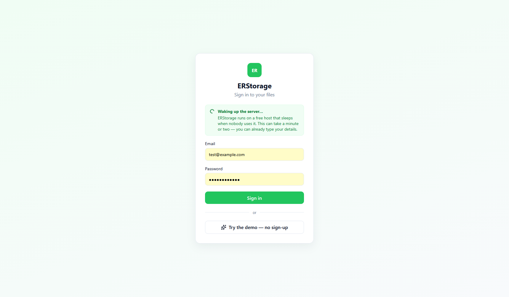
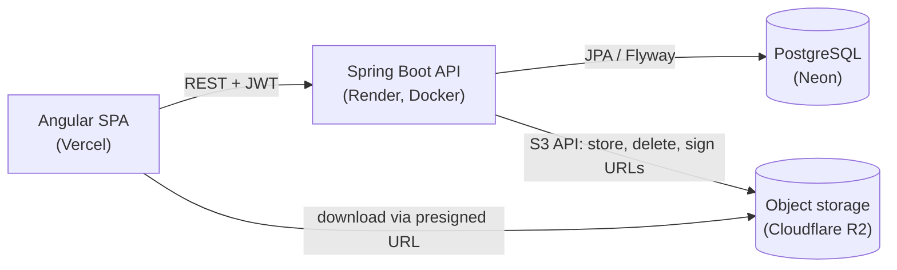

# ERStorage

A personal cloud file manager: folders, uploads with live progress, downloads, rename/move/delete, storage quotas, and a one-click guest demo.

Built with **Java 25 + Spring Boot 4** and **Angular 22**, deployed for free on **Render**, **Neon**, **Cloudflare R2** and **Vercel**.

**▶ Live demo: [YOUR-APP.vercel.app](https://YOUR-APP.vercel.app)**. Click **"Try the demo"**, no sign-up needed.

> The API runs on a free tier that sleeps when nobody uses it. The first visit can take a minute while it wakes up; the app shows a banner while it does.



---

## Features

- **Accounts**: JWT authentication, BCrypt-hashed passwords; registration closed by default
- **Folders**: create, rename, move (with a folder picker), delete recursively, breadcrumbs
- **Files**: upload several at once with per-file progress, cancel and retry, drag & drop from the desktop; download through short-lived signed links; rename, move, delete
- **Storage quotas**: a per-user quota plus a global cap for the whole app, both enforced atomically in the database
- **Guest demo mode**: each visitor gets a private, temporary account (1 hour, 20 MB, images/PDF/text only) with sample folders, deleted automatically afterwards
- **Cold-start handling**: the frontend wakes the API as soon as the app opens and tells the user what is happening
- Sortable list, responsive layout, keyboard-accessible dialogs, consistent error messages

## Architecture



- **Metadata** (users, folders, files) lives in PostgreSQL; **file bytes** live in S3-compatible object storage.
- **Uploads** go through the API, which checks ownership, name conflicts, blocked types and quota before storing anything.
- **Downloads** never pass through the API: it returns a presigned URL valid for 5 minutes, and the browser downloads directly from R2.
- Locally, Docker Compose runs PostgreSQL and **RustFS** (S3-compatible), so the same code runs against R2 in production.

## Tech stack

| Area | Technologies |
|---|---|
| Backend | Java 25, Spring Boot 4.1 (Web MVC, Security, Data JPA, Validation, Actuator), Spring Security OAuth2 Resource Server (JWT, HS256), Hibernate, Flyway, AWS SDK v2 (S3) |
| Database & storage | PostgreSQL 17, Cloudflare R2, RustFS (local) |
| Frontend | Angular 22 (standalone components, signals, `rxResource`, reactive forms, functional interceptors and guards), TypeScript, SCSS, Lucide icons, pnpm |
| Testing | JUnit 6, Testcontainers (real PostgreSQL), Mockito, AssertJ |
| DevOps | Docker (multi-stage, non-root), GitHub Actions CI, Render, Neon, Vercel |

## Design decisions worth a look

- **Atomic quota reservation.** One `UPDATE … WHERE used + size <= quota AND total + size <= globalCap` both checks and reserves space, so two parallel uploads can never exceed a quota. If storing the file or saving its row fails, the reservation and the stored object are rolled back or cleaned up (compensating actions across PostgreSQL and S3).
- **Ownership as 404.** Every lookup is `findByIdAndOwnerId`: another user's folder looks exactly like a folder that doesn't exist, so IDs can't be probed.
- **Same error for unknown email and wrong password.** Prevents account enumeration.
- **Fail-closed configuration.** Registration and demo mode are off unless explicitly enabled; required settings (JWT secret, storage limits) are validated at startup with `@Validated @ConfigurationProperties`.
- **Consistent errors.** Every error is an RFC 9457 `ProblemDetail`, which the frontend turns into readable messages.
- **Guest demo isolation.** Demo users are real, separate accounts with an allow-list of file types, a small quota, an expiring token, a cap on active guests, per-IP rate limiting, and a scheduled job that deletes expired guests and their stored files (database rows first, bytes after the transaction commits).
- **Upload progress.** Angular 22 defaults to the Fetch backend, which can't report upload progress, so the app opts back into XHR (`withXhr()`).

## Running locally

**Requirements:** JDK 25, Docker Desktop, Node.js and pnpm.

```bash
# Backend (starts PostgreSQL + RustFS through Docker Compose automatically)
cd backend
JWT_SECRET=any-local-secret-at-least-32-characters-long \
REGISTRATION_ENABLED=true \
DEMO_ENABLED=true \
./mvnw spring-boot:run

# Frontend
cd frontend
pnpm install
pnpm start
```

Open <http://localhost:4200> and click **Try the demo**, or register a user:

```bash
curl -X POST http://localhost:8080/api/v1/auth/register \
  -H "Content-Type: application/json" \
  -d '{"email":"me@local.test","password":"password123","displayName":"Me"}'
```

### Configuration

| Variable | Default | Purpose |
|---|---|---|
| `JWT_SECRET` | none, required | HMAC key for signing tokens (at least 32 characters) |
| `REGISTRATION_ENABLED` | `false` | allow `POST /auth/register` |
| `DEMO_ENABLED` | `false` | allow guest demo sessions |
| `TOTAL_STORAGE_LIMIT` | `8GB` | global storage cap for all users together |
| `STORAGE_ENDPOINT`, `STORAGE_REGION`, `STORAGE_ACCESS_KEY`, `STORAGE_SECRET_KEY`, `STORAGE_BUCKET` | local RustFS | S3-compatible storage |
| `CORS_ALLOWED_ORIGINS` | `http://localhost:4200` | comma-separated frontend origins |
| `SPRING_DATASOURCE_URL` / `_USERNAME` / `_PASSWORD` | Docker Compose | PostgreSQL connection |

## Tests

```bash
cd backend
./mvnw verify
```

Integration tests start the full application against a **real PostgreSQL in Docker** (Testcontainers) and call the HTTP API: authentication, folder trees, recursive deletes, quotas, uploads, and the demo lifecycle, including cleanup of expired guests. Object storage is mocked so tests stay fast and offline. Unit tests cover the registration lock and the demo rate limiter. GitHub Actions runs everything on every push to `main`.

## API overview

All endpoints are under `/api/v1`. Everything except `auth/*` and `/actuator/health` requires `Authorization: Bearer <token>`.

| Method | Path | Description |
|---|---|---|
| `POST` | `/auth/register` | create an account (when enabled) |
| `POST` | `/auth/login` | get a JWT |
| `POST` | `/auth/demo` | start a temporary guest session |
| `GET` | `/users/me` | current user and storage usage |
| `GET` | `/folders/root`, `/folders/{id}` | folder contents with breadcrumbs |
| `POST` | `/folders` | create a folder |
| `PATCH` | `/folders/{id}/rename`, `/folders/{id}/move` | rename / move a folder |
| `DELETE` | `/folders/{id}` | delete a folder and everything inside |
| `POST` | `/files` | upload a file (multipart) |
| `GET` | `/files/{id}/download` | get a presigned download URL |
| `PATCH` | `/files/{id}/rename`, `/files/{id}/move` | rename / move a file |
| `DELETE` | `/files/{id}` | delete a file |

## How AI was used

I built ERStorage with an AI assistant (Claude) as a pair programmer and tutor. I used it to discuss architecture and trade-offs, to explain Spring and Angular concepts while I learned them, and to draft code that I then typed in, ran, tested and debugged myself.

Real problems I diagnosed and fixed along the way include a Hibernate `TransientPropertyValueException` when deleting folder trees (solved with DTO projections), a Flyway checksum mismatch, Testcontainers/Docker API issues on Windows, Angular 22's switch to Fetch silently breaking upload progress, and a missing configuration default that left registration open in production (fixed by making it fail closed and adding a test).

I checked that the tests were meaningful by deliberately breaking the code they cover (manual mutation testing) and confirming they failed.

## Roadmap

- **v2:** search and filters, trash with 30-day auto-empty, image/PDF previews and thumbnails, share links, a grid view, right-click menu, moving by drag & drop inside the app, an offline action queue for cold starts
- **v3:** JavaFX desktop client using the same API, starred/pinned folders, activity log, dark mode, file versioning
